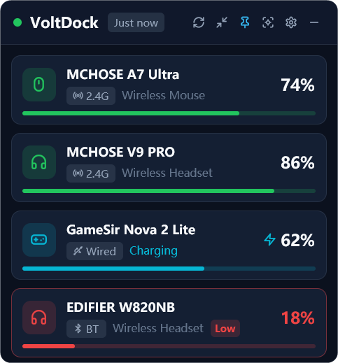
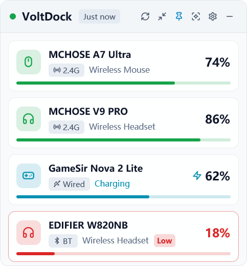
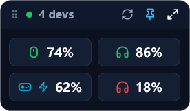
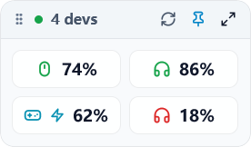
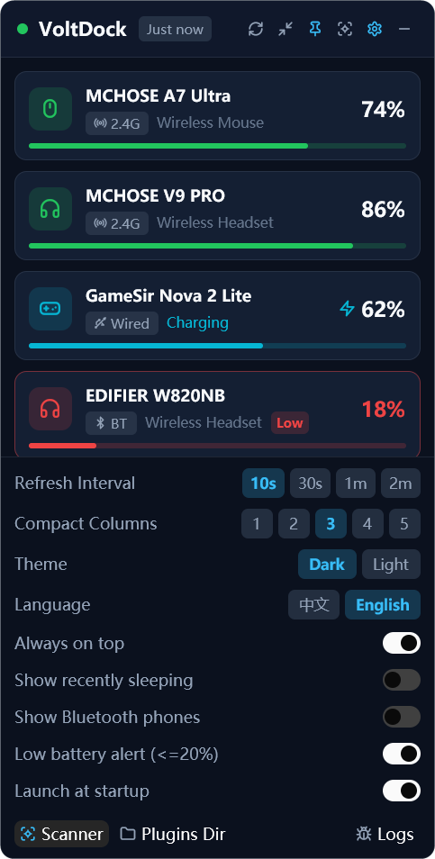
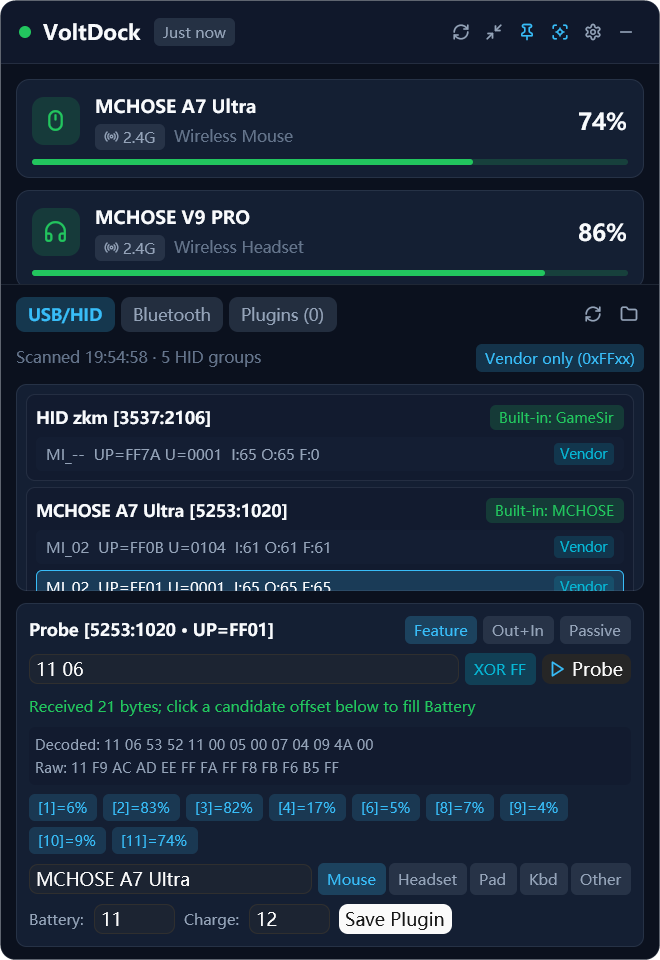

<div align="center">

# ⚡ VoltDock

**Lightweight Windows desktop battery widget for wireless peripherals · Built with Rust + GPUI Kit (`gpui-kit`)**

Monitor real-time battery level and charging status for **2.4GHz USB dongle / wired** and **Bluetooth (Classic + BLE GATT)** mice, headsets, gamepads, and keyboards in one clean overlay — without installing bloated vendor suites.


<p>
  <a href="README.md">简体中文</a> &nbsp;|&nbsp; <b>English</b>
</p>

</div>

---

## Preview

### Full Card Mode (Dark / Light Theme)

<p align="center">
  
  &nbsp;&nbsp;&nbsp;
  
</p>
<p align="center">
  <sub>Device icons, connection badges (<code>2.4G</code> / <code>BT</code> / <code>Wired</code>), charging indicators, tiered progress bars, and low-battery alerts</sub>
</p>

### Compact Floating Bar (Adaptive Single-Row Pill / Multi-Row Grid)

<p align="center">
  
</p>
<p align="center">
  
  &nbsp;&nbsp;&nbsp;&nbsp;
  
</p>
<p align="center">
  <sub>Expands horizontally on a single row and automatically switches to a symmetric grid card with a slim draggable top bar when wrapped, with built-in refresh/pin/expand buttons and hover tooltips</sub>
</p>

### Settings Drawer & Device Scanner / Protocol Prober

<p align="center">
  
  &nbsp;&nbsp;&nbsp;&nbsp;
  
</p>
<p align="center">
  <sub>Left: Refresh interval, compact columns, theme, Chinese/English language switcher, sleeping cache & startup &nbsp;|&nbsp; Right: One-click HID & Bluetooth scan, live probe frames & JSON plugin generator</sub>
</p>

---

## Key Features

- **Dual Floating Widget Modes**:
  - **Full Card Mode**: Displays device category icons, transport badges (`2.4G` / `Bluetooth` / `BLE` / `Wired`), charging/discharging state, exact battery percentage, low-battery highlights, and tiered progress bars.
  - **Compact Floating Bar**: Shows a sleek `42px` horizontal pill when devices fit on a single line; when active devices exceed the configured per-row limit (`1–5`), automatically switches to a **symmetric grid card with a slim draggable `28px` mini-header** — both featuring quick Refresh, **Always-on-Top Pin**, and Expand controls. Hover any chip to inspect the full device name and connection type.
- **Bilingual Interface (中文 / English)**:
  - Instant **Chinese / English** UI switching directly from the Settings drawer (persists across restarts and applies to widget cards, compact bar, scanner wizard, tray menu, and low-battery notifications).
- **Connected-Only Filtering & Edge-Aware Auto Expansion**:
  - Powered-off or disconnected 2.4GHz receivers are hidden automatically so the window shrinks strictly to active devices (optionally enable **"Show recently sleeping devices"** in settings to keep cached readings for 30 minutes).
  - Anchors to the nearest screen work-area edge — expanding right when docked left, left when docked right, up when docked at the bottom, and down when docked at the top — never overlapping the taskbar or screen edges.
- **JSON Plugin System + Visual Protocol Prober**:
  - Add support for niche brands declaratively via `.json` plugin files (supports HID Feature reports, Interrupt IN/OUT, XOR masks, checksums, and custom BLE GATT UUIDs).
  - Built-in **USB/HID & Bluetooth Scanner**: inspects local HID interface attributes (`VID`, `PID`, `MI`, `UsagePage`, `Usage`, report lengths) and paired Bluetooth devices, sends live test frames, highlights candidate battery byte offsets, and exports ready-to-use plugins in one click.
- **Lightweight Tray Integration & Single-Instance Protection**:
  - Left-click the tray icon to toggle visibility; right-click for quick refresh, always-on-top, compact mode, scanner, or quit. Re-launching brings the existing window to the front, with optional user-level Windows startup registration.

---

## Supported Devices & Protocols

| Category / Brand | Coverage | Transport |
| :--- | :--- | :--- |
| **MCHOSE Mice** | A7 Ultra / A7 V2 Ultra / M7 Ultra / L7 Series / K7 (`0x5253` / `0x3837`), G7, A5 Pro Max | 2.4GHz / Wired |
| **MCHOSE Headsets** | V9 Pro (`0x291D:0x385D`), X9, V9 Turbo / Turbo+ | 2.4GHz / Wired |
| **GameSir Controllers** | Nova 2 Lite and Zikway/Sapjoy proprietary dongles (`0x3537` / `0xFF7A`, including `0xFF` charging detection) | 2.4GHz / Wired |
| **Generic Bluetooth** | Bluetooth / BLE headsets, TWS earbuds, keyboards, mice, controllers, and phones reporting OS PnP or GATT `0x180F` battery | Bluetooth Classic / BLE |
| **Gamepads** | Xbox (WGI / XInput 4-level fallback), Sony DualSense / DualShock 4, Switch Pro / Joy-Con, 8BitDo, FlyDigi | 2.4GHz / Bluetooth / Wired |
| **More 2.4GHz Brands** | Logitech HID++ 2.0, Razer (90B Feature Report), SteelSeries, HyperX, Corsair, CompX ODM (VGN/ATK/Dragonfly/Aula, etc.), and standard HID Power (`0x0084`/`0x0085`) | 2.4GHz / Wired |
| **Custom Plugins** | Support any niche HID or BLE GATT peripheral via user `.json` plugin configs | 2.4GHz / Bluetooth / Wired |

---

## Quick Start

Download the prebuilt Windows x64 binary (`VoltDock-v0.2.0-windows-x64.zip` or `voltdock-v0.2.0-windows-x64.exe`) from [GitHub Releases](https://github.com/SinsAlgorithms/VoltDock/releases/latest) and run `voltdock.exe` directly — no runtime installer required (re-launching wakes and focuses the existing instance).

### CLI Diagnostics & Utilities

```powershell
# Probe all detected device batteries and print low-level diagnostics
.\voltdock.exe --probe

# Print the current poll report in JSON format
.\voltdock.exe --probe-json

# Scan all local USB HID driver attributes (VID/PID/MI/UsagePage/ReportLen) and Bluetooth devices
.\voltdock.exe --scan

# List plugin search directories and loaded custom plugins
.\voltdock.exe --plugins

# Test a single custom plugin JSON file
.\voltdock.exe --test-plugin "%APPDATA%\BatteryDisplay\plugins\my_device.json"

# Preview UI with built-in demo data (card-dark / card-light / compact-single / compact / compact-light / settings / scanner; optional --lang zh|en)
.\voltdock.exe --demo --lang en --demo-view card-dark
```

---

## Custom Device Plugins

VoltDock scans `*.json` plugin files from the following directories:
1. `%APPDATA%\BatteryDisplay\plugins\`
2. `plugins\` next to `voltdock.exe`

Example templates are generated in `plugins/examples/` on first launch (also included in [plugins/examples](plugins/examples)). Copy any `.json.example` file into your plugin folder, rename it to `.json`, and click **Refresh** or **Reload** to apply immediately.

### HID Plugin Config Example

```json
{
  "schema_version": 1,
  "id": "custom-mouse",
  "name": "Custom Wireless Mouse",
  "brand": "Custom",
  "kind": "Mouse",
  "connection": "Dongle24G",
  "enabled": true,
  "priority": 120,
  "transport": "hid",
  "match": {
    "vid": "0x5253",
    "pids": ["0x1020"],
    "usage_page": "0xFF01",
    "usage": "0x0001",
    "interface_number": 2
  },
  "protocol": {
    "mode": "feature_report",
    "report_id": "0x11",
    "report_len": 21,
    "request_hex": "11 06",
    "request_xor_mask": "0xFF",
    "request_xor_start": 1,
    "checksum": "none",
    "delay_ms": 60,
    "timeout_ms": 400,
    "retries": 3,
    "response_xor_mask": "0xFF",
    "response_xor_start": 1,
    "response_min_len": 13,
    "response_match": [
      { "offset": 0, "equals": "0x11" },
      { "offset": 1, "equals": "0x06" }
    ],
    "level": {
      "offset": 11,
      "mask": "0xFF",
      "shift_right": 0,
      "scale_max": 100,
      "min_valid": 0,
      "max_valid": 100
    },
    "charging": {
      "offset": 12,
      "mask": "0xFF",
      "nonzero": true
    }
  }
}
```

Key schema fields:
- **`kind`**: `"Mouse"` | `"Headset"` | `"Gamepad"` | `"Earbuds"` | `"Keyboard"` | `"Phone"` | `"Other"`
- **`connection`**: `"Dongle24G"` | `"Bluetooth"` | `"BluetoothLE"` | `"Wired"`
- **`protocol.mode`**: `"feature_report"` | `"output_input"` | `"output_with_feature_fallback"` | `"passive_input"`
- **`checksum`**: `"none"` | `"xor_last"` | `"sum_last"` | `"comp_x55"`
- Hex identifier fields (`vid`, `pids`, `usage_page`, `usage`, `mask`, `equals`) accept either `"0xXXXX"` strings or decimal integers.

> **Tip**: For devices with undocumented protocols, open **Scanner / Plugins** in the top-right toolbar, pick a `0xFFxx` vendor collection, send a test command, and let the UI decode and highlight candidate battery byte offsets for one-click `.json` plugin generation.

---

## Project Structure

```text
VoltDock/
├── docs/images/          # Showcase screenshots (with en/ English screenshots)
├── plugins/examples/     # Custom device plugin templates (HID / BLE GATT)
├── src/
│   ├── plugins/          # Plugin JSON schema parser, generic runner & HID/BT scanner
│   ├── providers/        # Built-in device protocol providers (MCHOSE / GameSir / BT / Gamepads / 2.4G)
│   ├── transport/        # Windows SetupAPI + Win32 Overlapped HID transport
│   ├── ui/               # GPUI Kit UI (full card, adaptive compact bar, settings, scanner wizard)
│   ├── config.rs         # User config persistence, v1 migration & crash logging
│   ├── manager.rs        # Background polling scheduler, channel dedup, sleep cache & low-battery alerts
│   └── platform_win.rs   # System tray, single-instance wake-up & edge-aware window positioning
├── Cargo.toml
├── LICENSE
├── README.md
└── README.en.md
```

---

## Build from Source

### Prerequisites
- Windows 10 / 11 (x64)
- [Rust Toolchain](https://rustup.rs/) (Edition 2024) with Windows MSVC build environment (Visual Studio C++ Build Tools + Windows SDK)

```powershell
# Run lint checks and unit tests
cargo clippy --all-targets -- -D warnings
cargo test

# Build release binary
cargo build --release
```

The compiled executable is placed at `target\release\voltdock.exe`.

---

## License

This project is open source under the [MIT License](LICENSE).
