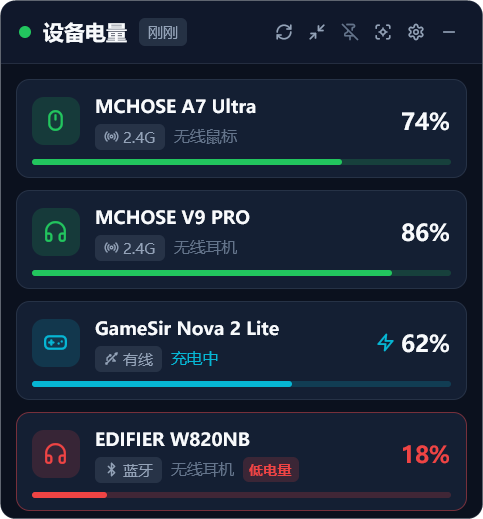
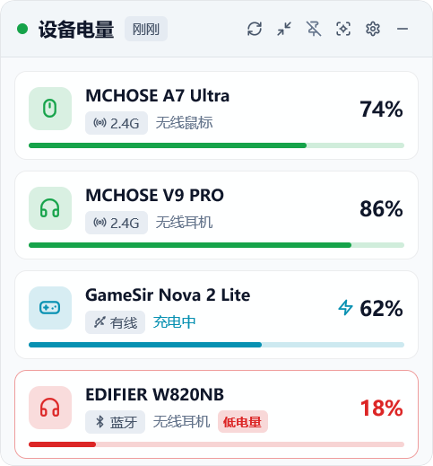
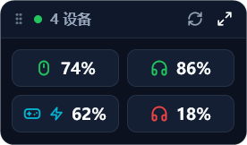
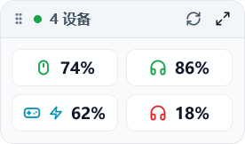
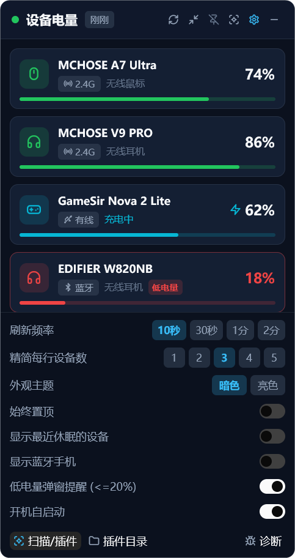
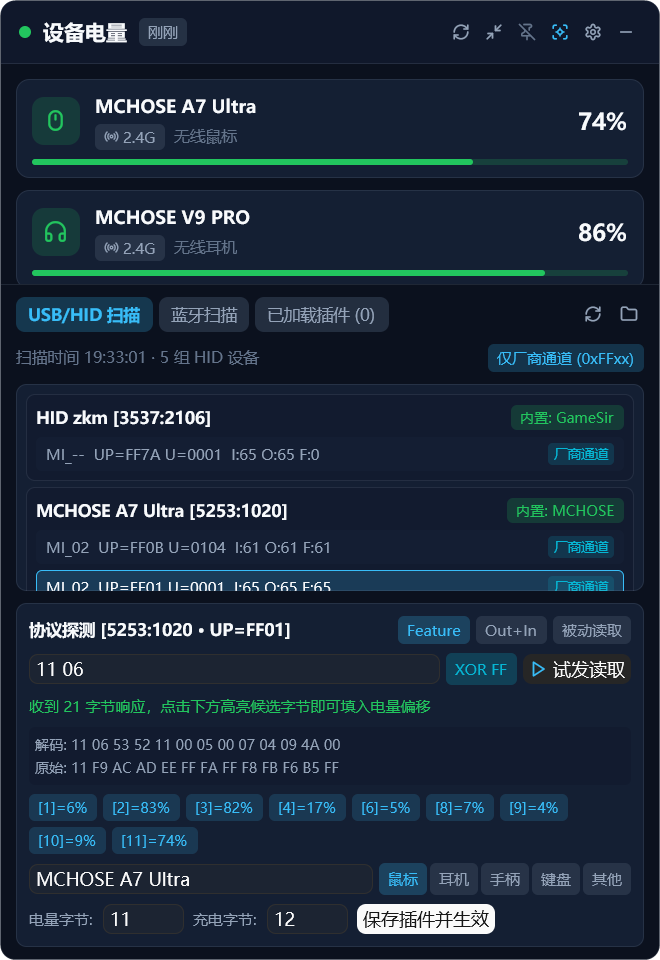

<div align="center">

# ⚡ VoltDock

**轻量级 Windows 桌面无线外设电量悬浮窗 · 基于 Rust + GPUI Kit (`gpui-kit`)**

无需安装各品牌臃肿的官方控制中心，统一监控 **2.4GHz 无线接收器 / 有线 USB** 与 **蓝牙（Classic + BLE GATT）** 鼠标、耳机、手柄和键盘的实时电量与充电状态。


</div>

---

## 界面预览

### 完整卡片模式（暗色 / 亮色主题）

<p align="center">
  
  &nbsp;&nbsp;&nbsp;
  
</p>
<p align="center">
  <sub>设备图标、连接徽章（<code>2.4G</code> / <code>蓝牙</code> / <code>有线</code>）、充放电状态、分级进度条与低电量高亮警示</sub>
</p>

### 精简悬浮条模式（单行横条 / 多行网格自适应）

<p align="center">
  
</p>
<p align="center">
  
  &nbsp;&nbsp;&nbsp;&nbsp;
  
</p>
<p align="center">
  <sub>单行自动横向舒展，多行自动切换带迷你顶栏的对称网格布局，支持抓手/胶囊区直接拖拽与悬停查看设备详情</sub>
</p>

### 设置抽屉 & 设备扫描与协议探测向导

<p align="center">
  
  &nbsp;&nbsp;&nbsp;&nbsp;
  
</p>
<p align="center">
  <sub>左：刷新频率、精简每行设备数、主题、休眠设备保留与开机自启 &nbsp;|&nbsp; 右：一键扫描 HID 驱动通道、试发指令并生成自定义设备插件</sub>
</p>

---

## 核心特性

- **双形态悬浮小组件**：
  - **完整卡片模式**：清晰呈现设备类型图标、连接徽章（`2.4G` / `蓝牙` / `BLE` / `有线`）、充放电状态、精确电量百分比、低电量警示与分级进度条。
  - **精简悬浮条模式**：单行少设备时呈现 `42px` 超薄横条；当在线设备超出每行上限（1–5 个可调）自动换行时，智能切换为**带迷你拖拽顶栏的对称网格卡片**，保持整体视觉紧凑对齐，鼠标悬停即可查看完整设备名与连接方式。
- **只显示已连接设备 + 边缘感知自适应扩展**：
  - 未开机或未建立连接的 2.4GHz 接收器默认自动隐藏，窗口尺寸严格贴合当前在线设备数量；也可按需在设置中开启“显示最近休眠的设备”。
  - 根据小组件当前停靠的屏幕工作区边缘自动决定延伸方向——靠左向右扩展、靠右向左扩展、靠底向上扩展、靠顶向下扩展，始终不越过屏幕边界或任务栏。
- **插件化扩展 + 可视化协议探测器**：
  - 支持编写声明式 `.json` 配置文件快速适配冷门品牌外设（HID 特征报告、Interrupt IN/OUT、XOR 掩码、校验和、BLE 自定义 GATT UUID 均可配置）。
  - 内置 **USB/HID & 蓝牙设备扫描器**：枚举本机 HID 接口属性（`VID`、`PID`、`MI`、`UsagePage`、`Usage`、Report 长度）与蓝牙配对设备，支持界面实时试发测试帧、自动标出候选电量字节，一键保存插件并立即生效。
- **低资源占用与系统托盘**：
  - 托盘左键快速显隐，右键支持立即刷新、置顶切换、切换精简模式、打开扫描器与退出；单实例防重保护（重复启动自动唤醒已有窗口置前）与用户级开机自启。

---

## 支持设备与协议

| 类别 / 品牌 | 支持范围 | 连接方式 |
| :--- | :--- | :--- |
| **迈从 MCHOSE 鼠标** | A7 Ultra / A7 V2 Ultra / M7 Ultra / L7 系列 / K7（`0x5253` / `0x3837`）、G7、A5 Pro Max | 2.4GHz / 有线 |
| **迈从 MCHOSE 耳机** | V9 Pro（`0x291D:0x385D`）、X9、V9 Turbo / Turbo+ | 2.4GHz / 有线 |
| **盖世小鸡 GameSir** | Nova 2 Lite 等 Zikway/Sapjoy 私有协议手柄接收器（`0x3537` / `0xFF7A`，支持 `0xFF` 充电态识别） | 2.4GHz / 有线 |
| **通用蓝牙设备** | 所有向系统上报电量的蓝牙/BLE 耳机、TWS、键盘、鼠标、手柄与手机（PnP + GATT `0x180F`） | 蓝牙 Classic / BLE |
| **游戏手柄** | Xbox（WGI / XInput 四段回退）、Sony DualSense / DualShock 4、Switch Pro / Joy-Con、8BitDo、飞智 FlyDigi | 2.4GHz / 蓝牙 / 有线 |
| **更多 2.4GHz 品牌** | Logitech HID++ 2.0、Razer（90B 特征报告）、SteelSeries、HyperX、Corsair、CompX ODM（VGN/ATK/蜻蜓/狼蛛等）及标准 HID 电池（`0x0084`/`0x0085`） | 2.4GHz / 有线 |
| **自定义扩展** | 通过用户 `.json` 插件适配任意冷门 HID / BLE GATT 设备 | 2.4GHz / 蓝牙 / 有线 |

---

## 快速使用

直接运行编译产物 `voltdock.exe` 即可在桌面显示电量小组件（若后台已在运行，再次打开会自动唤醒并置前）。

### 命令行辅助工具

```powershell
# 查看所有检测到的设备电量与底层诊断日志
.\voltdock.exe --probe

# 以 JSON 格式输出当前探测结果
.\voltdock.exe --probe-json

# 扫描本机全部 USB HID 驱动属性（VID/PID/MI/UsagePage/ReportLen）与蓝牙设备
.\voltdock.exe --scan

# 查看插件目录与已加载的自定义插件
.\voltdock.exe --plugins

# 单独测试某个自定义插件 JSON 文件
.\voltdock.exe --test-plugin "%APPDATA%\BatteryDisplay\plugins\my_device.json"

# 使用内置演示数据预览界面（card-dark / card-light / compact-single / compact / compact-light / settings / scanner）
.\voltdock.exe --demo --demo-view card-dark
```

---

## 自定义设备插件指南

VoltDock 会自动扫描以下目录中的 `*.json` 插件文件：
1. `%APPDATA%\BatteryDisplay\plugins\`
2. 与 `voltdock.exe` 同级的 `plugins\` 目录

首次启动时会自动生成示例模板目录 `plugins/examples/`（仓库中亦附带于 [plugins/examples](plugins/examples)），将 `.json.example` 复制并重命名为 `.json` 放入插件目录后点击刷新或重载即可生效。

### HID 插件配置示例

```json
{
  "schema_version": 1,
  "id": "custom-mouse",
  "name": "自定义无线鼠标",
  "brand": "Custom",
  "kind": "Mouse",
  "connection": "Dongle24G",
  "enabled": true,
  "priority": 120,
  "transport": "hid",
  "match": {
    "vid": "0x5253",
    "pids": ["0x1020"],
    "usage_page": "0xFF01",
    "usage": "0x0001",
    "interface_number": 2
  },
  "protocol": {
    "mode": "feature_report",
    "report_id": "0x11",
    "report_len": 21,
    "request_hex": "11 06",
    "request_xor_mask": "0xFF",
    "request_xor_start": 1,
    "checksum": "none",
    "delay_ms": 60,
    "timeout_ms": 400,
    "retries": 3,
    "response_xor_mask": "0xFF",
    "response_xor_start": 1,
    "response_min_len": 13,
    "response_match": [
      { "offset": 0, "equals": "0x11" },
      { "offset": 1, "equals": "0x06" }
    ],
    "level": {
      "offset": 11,
      "mask": "0xFF",
      "shift_right": 0,
      "scale_max": 100,
      "min_valid": 0,
      "max_valid": 100
    },
    "charging": {
      "offset": 12,
      "mask": "0xFF",
      "nonzero": true
    }
  }
}
```

核心字段说明：
- **`kind`**：`"Mouse"` | `"Headset"` | `"Gamepad"` | `"Earbuds"` | `"Keyboard"` | `"Phone"` | `"Other"`
- **`connection`**：`"Dongle24G"` | `"Bluetooth"` | `"BluetoothLE"` | `"Wired"`
- **`protocol.mode`**：`"feature_report"` | `"output_input"` | `"output_with_feature_fallback"` | `"passive_input"`
- **`checksum`**：`"none"` | `"xor_last"` | `"sum_last"` | `"comp_x55"`
- 十六进制标识字段（`vid`、`pids`、`usage_page`、`usage`、`mask`、`equals`）支持 `"0xXXXX"` 字符串或十进制整数。

> **提示**：对于未知协议的冷门设备，推荐使用小组件右上角的 **「扫描/插件」** 按钮：选中对应 `0xFFxx` 厂商通道后试发指令，界面会自动解密并标出可能的电量字节位置，点击即可直接生成可用的 `.json` 插件文件。

---

## 目录结构

```text
VoltDock/
├── docs/images/          # 界面展示截图
├── plugins/examples/     # 自定义设备插件参考模板（HID / 蓝牙 GATT）
├── src/
│   ├── plugins/          # 插件 JSON Schema 解析、通用协议执行器与 HID/蓝牙扫描器
│   ├── providers/        # 内置各品牌设备协议实现（MCHOSE / GameSir / 蓝牙 / 手柄 / 主流外设）
│   ├── transport/        # Windows SetupAPI + Win32 Overlapped HID 通信层
│   ├── ui/               # GPUI Kit 界面（完整卡片、精简换行悬浮条、设置抽屉、扫描探测向导）
│   ├── config.rs         # 用户配置持久化、版本迁移与异常崩溃日志
│   ├── manager.rs        # 后台轮询调度、多通道去重、休眠状态缓存与低电量提醒
│   └── platform_win.rs   # 系统托盘、单实例唤醒与边缘感知窗口定位引擎
├── Cargo.toml
├── LICENSE
└── README.md
```

---

## 从源码构建

### 环境要求
- Windows 10 / 11（x64）
- [Rust 工具链](https://rustup.rs/)（Edition 2024）与 Windows MSVC 构建环境（Visual Studio C++ Build Tools + Windows SDK）

```powershell
# 运行静态检查与单元测试
cargo clippy --all-targets -- -D warnings
cargo test

# 编译 Release 版本
cargo build --release
```

编译产物位于 `target\release\voltdock.exe`。

---

## 开源协议

本项目基于 [MIT License](LICENSE) 开源。
